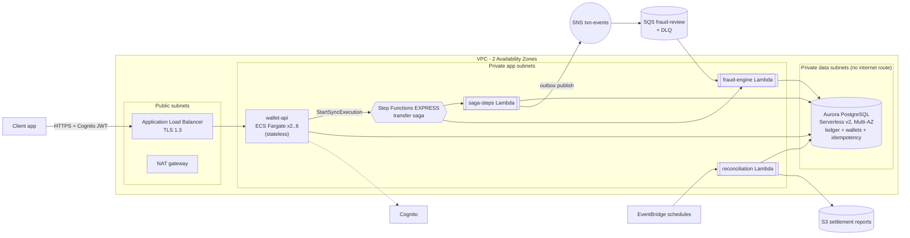

# Mobile Money Platform — Design Document

> Cloud Application Development mini project. Read with `README.md` (how to run) and `RUNBOOK.md` (operations).
> Sections 9 and 10 contain figures that are **estimates until the team replaces them with Cost Explorer actuals** — see the notes there.

## 1. Goals and the one rule that shapes everything

A payments platform where **correctness under concurrency and failure is non-negotiable**. Every design choice below
serves three invariants, each enforced by the database and proved by an automated test:

| Invariant | Enforced by | Proved by |
|---|---|---|
| Replaying a request any number of times debits **once** | `idempotency_keys` primary key + deterministic txn id + `UNIQUE (txn_id, step, direction)` on the ledger | `scripts/proofs/run_proofs.py` §1, `tests/integration/test_idempotency.py` |
| A failure mid-transaction **creates or destroys no money** | Saga with compensation, every step idempotent, double-entry ledger, `SUM(balances) = 0` | proof §2 (crash injected at 5 points), `tests/integration/test_saga.py` |
| Concurrent debits **never overdraw** | `SELECT … FOR UPDATE` in sorted order, balance checked *after* the lock, `CHECK (balance >= 0)` backstop | proof §3 (50 parallel), `tests/integration/test_ledger.py` |

## 2. Architecture



### 2.1 Independently deployable services (requirement: ≥ 3)

| # | Service | Runtime | Deploy unit | Trigger |
|---|---|---|---|---|
| 1 | **wallet-api** — wallets, transfers, merchant payments, agent cash-in/out, reversals, disputes | ECS Fargate container | ECR image, blue/green via CodeDeploy | ALB (HTTPS) |
| 2 | **saga-steps** — one saga step per call (reserve, credit, finalize, compensations) | Lambda | `saga-steps.zip` | Step Functions |
| 3 | **fraud-engine** — sync decision inside the saga + async post-completion review | Lambda | `fraud-engine.zip` | Step Functions + SQS |
| 4 | **reconciliation** — integrity checks, settlement reports, outbox sweep | Lambda | `reconciliation.zip` | EventBridge schedules |
| — | **db-init** — applies `db/schema.sql` | Lambda | `db-init.zip` | Terraform |

The saga orchestrator itself is a fifth moving part: a Step Functions state machine defined in `statemachine/transfer_saga.asl.json`.
Each service has its own IAM role, its own log group and its own artifact, and can be released without touching the others.
(They share one `momo` Python package in the repo; the deployable units are separate.)

### 2.2 Asynchronous communication (requirement: ≥ 1 path)

`finalize` writes a `TransactionCompleted` row to the **outbox table in the same database transaction as the ledger change**.
The row is published to **SNS → SQS** immediately after commit, and a 5-minute EventBridge sweep publishes anything missed
(process died between commit and publish). The fraud consumer is idempotent (`UNIQUE (txn_id, decision)`), so SQS's
at-least-once delivery is safe. Messages failing 5 times go to a **DLQ with an alarm**.
This is the standard transactional-outbox pattern: no completed transaction can be absent from the event stream.

### 2.3 Stateless application tier (requirement)

The API keeps **no session, no local files, no in-process state that affects correctness**; the root filesystem is read-only.
Identity is a Cognito JWT verified on every request; all state is in Aurora. Any task can serve any request, which is what
allows ECS to add and remove tasks freely and CodeDeploy to swap task sets. A request begun on one task and retried on another
produces the same result because the idempotency record lives in the database, not in memory.

### 2.4 Two Availability Zones

* ALB in two public subnets; ECS service spread over two private app subnets (min 2 tasks, one per AZ by the scheduler's default spread);
  Lambdas attached to both app subnets.
* **Aurora**: writer and reader in *different* AZs; storage is replicated 6 ways across 3 AZs; automatic failover (promotion tier 0 → 1).
* **Known single point**: one NAT gateway (cost optimisation §10.2). If its AZ fails, *outbound-internet* calls from the app tier
  (Cognito JWKS refresh, public image pulls) fail until it recovers; the DB path and already-running tasks are unaffected.
  Set `single_nat_gateway = false` for per-AZ egress.

## 3. Data store choice

**Aurora PostgreSQL (Serverless v2), Multi-AZ**, justified by the access patterns:

| Access pattern | Why relational |
|---|---|
| Move money between two wallets atomically | Multi-row ACID transaction; one commit covers both balances and both ledger rows |
| 50 concurrent debits of one wallet must serialise | Row-level locks (`FOR UPDATE`) — a primitive DynamoDB does not offer; it would push locking into application code |
| Exactly-once per Idempotency-Key | `PRIMARY KEY`/`UNIQUE` constraints make duplicates impossible *by construction* |
| Immutable ledger | Triggers + privileges at the database layer |
| Reconciliation | Set-based SQL aggregation (`SUM … GROUP BY`) across the whole ledger |

**DynamoDB considered and rejected** for the money path: conditional writes and transactions can do it, but the reconciliation
queries, the append-only enforcement and the 25-item transaction limit all push complexity upward. It would fit *read models*
(e.g. a mobile statement view) if load demanded it — a possible next step.

**QLDB was suggested in the brief but is unavailable**: AWS ended QLDB support in 2025, so it cannot be deployed into a clean account.
The immutable, verifiable ledger is therefore implemented in SQL:

* `ledger_entries` has `BEFORE UPDATE OR DELETE` and `BEFORE TRUNCATE` triggers that raise an error; the application role is also
  `REVOKE`d UPDATE/DELETE/TRUNCATE (defence in depth).
* Corrections are **new compensating entries**, never edits (reversals are a new `REVERSAL` transaction).
* **Per-wallet SHA-256 hash chain**: each entry hashes its predecessor, so changing, deleting or reordering any entry breaks every later
  hash. The hourly reconciliation recomputes all chains. A test tampers with a row as a superuser (triggers disabled) and proves
  the verifier detects it (`test_hash_chain_verifies_and_detects_tampering`).
* Honest limitation: unlike QLDB, a database superuser who *also* recomputes the whole chain could rewrite history. Mitigation:
  publish periodic chain-head hashes to the write-once S3 settlement bucket (the daily report is the place to add this) and keep
  CloudTrail on. Called out as future work, not hidden.

### 3.1 Data model (`db/schema.sql`)

`wallets` (balance, hash-chain head) · `transactions` · `ledger_entries` (append-only double entry) · `idempotency_keys` ·
`sagas` (state per transaction) · `outbox_events` · `fraud_alerts` · `disputes` · `settlement_reports`.
Money is `BIGINT` minor units (ngwee) — never floating point. Two system wallets: **MINT** (the only wallet allowed to go negative =
total e-money issued) and **ESCROW** (holds funds between `reserve` and `credit`). Therefore **`SUM(wallet balances) = 0` always**,
which reconciliation asserts.

## 4. Correctness under failure

### 4.1 Idempotency — "replay 100 times ⇒ exactly one debit"

1. Client sends `Idempotency-Key`. The transaction id is `uuid5(actor:type, key)` — deterministic.
2. `idempotency.begin()` inserts `(scope, key)` as `IN_PROGRESS`; the primary key makes concurrent duplicates serialise. Exactly one wins.
3. Duplicates receive the stored response (header `Idempotent-Replayed: true`), or wait ≤ 5 s for an in-flight original, else `409 + Retry-After`.
4. Same key with a **different body** → `422 IDEMPOTENCY_KEY_REUSED` (a client bug we refuse to guess about).
5. If the winner crashed, the 30 s lease expires and one retry *takes over*. Because the txn id is deterministic and every saga step is
   idempotent, resuming cannot double-post; if the saga already finished, its recorded outcome is reused instead of re-running.
6. Rejections are idempotent too: a replay of a declined request returns the same decline (use a new key to retry deliberately).

Even if all of 1–5 were bypassed, the ledger's `UNIQUE (txn_id, step, direction)` makes a second debit **physically impossible**.

### 4.2 Saga — "failure mid-transaction leaves no money created or destroyed"

```
reserve  (payer -> ESCROW)        fails fast on insufficient funds
fraud    (no money moves)         DECLINE -> release
credit   (ESCROW -> payee)
finalize (mark COMPLETED, write outbox event)

compensation (decided from DB state, safe to call blindly, any number of times):
  reverse_credit (payee -> ESCROW)  only if credit applied and not yet reversed
  release        (ESCROW -> payer)  only if reserve applied and not yet released; refuses to run before reverse_credit
```

* Every step is **one local ACID transaction** and **idempotent on `(txn_id, step)`**, checked *after* the row locks are taken.
* **Business outcomes are data, not exceptions**: insufficient funds / frozen wallet are returned as `{ok:false, code}`;
  only technical failures raise and enter compensation.
* **Ambiguous outcome** (crash *after* credit committed, before the caller learned of it) is the nastiest case; compensation is
  state-driven, so it correctly reverses the credit it did not hear about. This is fault point `credit.after` in the proof.
* If compensation itself fails after 5 retries the saga becomes `COMPENSATION_FAILED`, the Step Functions execution **fails**
  (alarm `saga-compensation-failed`), and funds sit safely in ESCROW for an operator (RUNBOOK). Money is still conserved.
* Why **Step Functions Express (synchronous)**: the API needs the outcome in the HTTP response; Express is ~100× cheaper than Standard
  (§10.1) and its at-least-once semantics are safe because steps are idempotent. A Python orchestrator with identical logic
  (`saga/orchestrator.py`) is the reference implementation used by tests; `tests/unit/test_asl.py` statically checks the state machine
  cannot lose a compensation route.

**Fault-injection evidence.** `X-Fault-Inject: <point>` (only when `ENABLE_FAULT_INJECTION=true`, off in production) crashes the saga at
`reserve.after`, `fraud.before`, `credit.before`, `credit.after`, `finalize.before`. For each, the proof asserts the payer is made whole, the
payee unchanged, ESCROW empty and global integrity holds.

### 4.3 Concurrency — "50 concurrent transfers never overdraw"

`ledger.move()` locks **both** wallet rows with `FOR UPDATE` **in sorted-id order** (so opposite transfers cannot deadlock), *then* checks
the balance, *then* writes. Test: payer holds 1000; 50 parallel transfers of 30 → **exactly 33 succeed, 17 get `INSUFFICIENT_FUNDS`**, final balance 10,
every historical `balance_after ≥ 0`. A `CHECK (balance >= 0)` constraint is the backstop if application code is ever wrong.
A separate test runs 200 opposite-direction transfers between two wallets to show there is no deadlock.

### 4.4 Reversals and disputes

Reversal = a **new** `REVERSAL` transaction (payee → payer) run through the same saga; the original ledger entries are untouched. At most one live
reversal per transaction (partial unique index). If the payee has already spent the money, the reversal is *rejected cleanly* (`INSUFFICIENT_FUNDS`) — funds are never
created. A dispute is raised by either party; an admin resolves it with `REVERSE` (key derived from the dispute id, so resolving twice cannot reverse twice) or `REJECT`.

### 4.5 Fraud rules engine

Pure functions (`fraud/rules.py`, 100 % covered), I/O isolated in `fraud/service.py`, thresholds tunable at runtime in SSM Parameter Store (no redeploy):

| Rule | Trigger | Decision |
|---|---|---|
| Velocity | ≥ 5 transactions from a wallet in 60 s | DECLINE (saga releases the hold) |
| Unusual amount | > hard cap, or > 5× the wallet's 30-day average (with history) | DECLINE / REVIEW |
| Geographic anomaly | > 50 km from the previous location at an impossible speed (> 900 km/h) | REVIEW |
| Daily volume (async) | > ZMW 100,000 outgoing in 24 h | REVIEW (alert) |

REVIEW completes the payment but writes a `fraud_alerts` row. System traffic (float top-ups, reversals) is exempt.

### 4.6 Reconciliation and settlement

Hourly and daily (`reconciliation/report.py`). All must hold or `ReconciliationDiscrepancies` fires a P1 alarm: conservation `SUM(balances)=0`;
ledger nets to zero; every (txn, step) balances; each wallet balance equals the sum of its entries; every hash chain recomputes; no saga stuck
`PENDING` > 5 min or `COMPENSATION_FAILED`; ESCROW equals the funds held by in-flight transactions. The daily report also summarises volume per type/status,
per-merchant gross settlements and agent float, stored in `settlement_reports` and archived (KMS-encrypted) to S3.

## 5. Security

| Requirement | Implementation |
|---|---|
| **No credentials in source control, scan confirms** | None exist: the DB uses **IAM authentication** (15-min tokens, no password); the only DB password is RDS-managed in Secrets Manager and read by one Lambda; tests generate throw-away RSA keys in memory. `gitleaks` runs on **full history** in CI and **fails the build** (no allowlists; a strict default-rules scan of the tracked files reports *no leaks*); `.gitignore` blocks `.env`, `*.pem`, `*.tfvars`, tfstate. |
| **Secrets in Secrets Manager / Parameter Store** | DB master secret: Secrets Manager (`manage_master_user_password`, KMS-encrypted, rotation managed by RDS). Fraud thresholds: SSM. Cognito IDs / ARNs in env vars are identifiers, not secrets. |
| **Least-privilege IAM** | Separate role per service; table below. No `*` actions; `*` resources only where AWS offers no resource-level scoping (marked). |
| **Encryption at rest** | Aurora, S3, SQS, SNS, ECR, CloudWatch Logs, CloudTrail, Secrets Manager — all with customer-managed KMS keys with rotation. |
| **Encryption in transit** | ALB TLS 1.3/1.2 policy; Aurora `rds.force_ssl=1` and `sslmode=require`; bucket/queue policies deny `aws:SecureTransport=false`; AWS SDK calls are TLS. |
| **App tier in private subnets** | ECS tasks and Lambdas in private app subnets, no public IPs; Aurora in data subnets with **no route to the internet**; security groups reference each other (ALB→API→DB), never CIDRs. |
| **Authentication** | Cognito user pool, optional TOTP MFA, 12-char password policy. API verifies RS256 signature via JWKS, `iss`, `token_use=access`, `client_id`, `exp`; **algorithm pinned** (alg-confusion / `none` rejected). Unit tests cover each failure mode (expired, wrong issuer, wrong client, ID token, missing claims, token signed by a foreign key, `HS256`/`none` downgrade). |
| **Authorization** | Cognito groups (`customers`, `merchants`, `agents`, `admins`) + ownership checks (spend only from *your* wallet; read only *your* ledger). Admin-only: float top-up, reversals, dispute resolution. Tested in `test_authorization_boundaries`. |
| **CloudTrail** | Multi-region trail, log-file validation, KMS-encrypted versioned S3 bucket with public-access block. |
| Other | Request body capped at 16 KB; strict input validation (integer amounts only, bool rejected); `Cache-Control: no-store`; container runs as non-root with read-only root FS; ECR scan-on-push; ALB drops invalid headers. |

### 5.1 IAM permissions and why each exists

| Role | Permission | Justification |
|---|---|---|
| ECS **execution** | `ecr:GetAuthorizationToken` (`*`), `ecr:BatchGetImage`/`GetDownloadUrlForLayer`/`BatchCheckLayerAvailability` on the one repo, `logs:CreateLogStream/PutLogEvents` on one log group, `kms:Decrypt` on data key | Pull its own image, write its own logs. `GetAuthorizationToken` cannot be resource-scoped. |
| ECS **task** (the running app) | `states:StartSyncExecution` on the saga ARN; `rds-db:connect` as `momo_app` only; X-Ray put (`*`, unscopable) | The only three things the API does. No S3, no Secrets Manager, no SQS. |
| **saga-steps** | `rds-db:connect`; `sns:Publish` on the events topic; `kms:GenerateDataKey/Decrypt` on data key; X-Ray; logs on its group; ENI create/delete (`*`, required for VPC Lambdas) | Run steps, publish outbox events. |
| **fraud-engine** | `rds-db:connect`; `ssm:GetParameter` on one parameter; SQS receive/delete on one queue; `kms:Decrypt`; X-Ray; logs; ENI | Decide, read thresholds, consume its queue. |
| **reconciliation** | `rds-db:connect`; `s3:PutObject` on `settlement/*` only; `sns:Publish`; KMS; X-Ray; logs; ENI | Write reports, sweep the outbox. |
| **db-init** | `secretsmanager:GetSecretValue` on the **one** master secret; `kms:Decrypt`; logs; ENI | The only identity that can see the DB admin password. |
| **Step Functions** | `lambda:InvokeFunction` on exactly two functions; X-Ray; log delivery (`*`, unscopable) | Call saga steps and fraud. |
| **CodeDeploy** | AWS-managed `AWSCodeDeployRoleForECS` | Standard managed policy for ECS blue/green. |

Database-level least privilege: the app role `momo_app` has `SELECT/INSERT/UPDATE` on operational tables, **only `SELECT/INSERT` on `ledger_entries`** (UPDATE/DELETE/TRUNCATE revoked), and cannot alter schema.

## 6. Engineering practice

* **100 % infrastructure as code** (`infra/terraform`, 127 resources): VPC, subnets, security groups, KMS, Aurora, **schema** (applied by the db-init Lambda from Terraform), Cognito, ECS/ALB/CodeDeploy, Lambdas, Step Functions, SNS/SQS, schedules, CloudTrail, dashboard, alarms, budget.
  A marker deploys with `scripts/deploy.sh <email>` (build artifacts → create ECR → push image → apply). No console steps. The only manual action is clicking the SNS confirmation e-mail.
* **CI/CD** (`.github/workflows/ci-cd.yml`): gitleaks (full history) → lint → unit + integration tests against a real PostgreSQL service container with a **coverage gate** → the three correctness proofs → `terraform fmt/validate` + tfsec → **deploy only if every gate is green**. AWS access via GitHub OIDC (no stored keys).
* **Automated rollback, demonstrated**: ECS blue/green via CodeDeploy with `auto_rollback_configuration` on `DEPLOYMENT_FAILURE` and `DEPLOYMENT_STOP_ON_ALARM` (5xx-rate and unhealthy-host alarms watch the traffic shift). `scripts/rollback_demo.sh` deploys a deliberately unhealthy release and records that CodeDeploy restores the previous task definition with no human action → `evidence-out/rollback-deployment.json`.
* **Tests**: 113 tests, **92 % coverage** (gate: 60 %) — unit (rules, auth, hashing, orchestrator, ASL structure) and integration (real PostgreSQL: ledger, saga faults, idempotency, API, reconciliation, outbox).
* **Git**: see `docs/TEAM_PLAN.md` — each member commits their own area.

## 7. Observability

| Requirement | Implementation |
|---|---|
| **Structured logs + correlation IDs across services** | JSON logs (`common/logging_setup.py`) with `correlation_id` and `trace_id` on every line. Flow: `X-Correlation-ID` header (or generated) → API → saga input → Step Functions → Lambdas → SNS message attribute → SQS → fraud consumer. Echoed in every response and error body. Logs Insights query in RUNBOOK finds one request across all services. |
| **Distributed tracing** | X-Ray: Flask middleware + daemon sidecar, `patch_all()` for boto3, Lambda active tracing, Step Functions tracing → one trace spans API → saga → Lambdas → DB calls. |
| **Dashboard — golden signals** | `${name}-golden-signals`: **Latency** (ALB p50/p95/p99 vs SLO line), **Traffic** (requests, saga starts), **Errors** (5xx, 4xx, saga failures, unhandled exceptions, business outcomes), **Saturation** (ECS CPU/mem, Aurora ACU + connections, queue depth, task count), plus alarm status. |
| **≥ 3 alarms with response actions** | 8 alarms, each with a documented response in its description and in RUNBOOK: 5xx rate, p95 latency, unhealthy hosts, DLQ not empty, saga compensation failed, reconciliation discrepancy, Aurora saturation, unhandled exceptions. All notify SNS → e-mail; the first two also gate deployments. |
| **SLIs / SLOs** | §7.1 |

### 7.1 SLIs and SLOs — core user journey: "send money"

Journey: `POST /transfers` (Idempotency-Key) → `201 COMPLETED` or a clean `422` rejection, and the money is where the receipt says it is.

| SLI (how measured) | SLO (30-day window) | Error budget | Alarm |
|---|---|---|---|
| **Availability** — requests not answered 5xx ÷ all requests (ALB `HTTPCode_Target_5XX / RequestCount`; 4xx are client/business outcomes and count as *good*) | **99.5 %** | 0.5 % ≈ 3.6 h of full outage | `api-5xx-rate` (> 2 % for 3/5 min) |
| **Latency** — ALB `TargetResponseTime` p95 for the whole synchronous saga | **p95 < 1 s** in ≥ 99 % of 5-min windows | 1 % of windows | `api-latency-p95` |
| **Correctness** — reconciliation runs with zero discrepancies ÷ runs | **100 %** (zero tolerance: money) | none | `reconciliation-discrepancy`, `saga-compensation-failed` |
| **Async freshness** — completed transactions reviewed by fraud within 60 s (no DLQ growth) | 99.9 % | 0.1 % | `fraud-dlq-not-empty` |

A *compensated* failure (500 + funds returned) counts against availability, because the customer's request did not succeed — but not against correctness.

## 8. Deployment checklist for a marker

`scripts/deploy.sh you@example.com` → confirm e-mail → `scripts/get_tokens.sh` → `scripts/proofs/run_proofs.py --base-url …` → `scripts/rollback_demo.sh` → `k6` + `scripts/autoscale_evidence.sh`. Exact commands in `README.md`.

## 9. Auto-scaling

ECS service on target tracking: **CPU 55 %** and **ALB requests per target 300/min**, min 2 / max 6 tasks, scale-out cooldown 60 s, scale-in 300 s. Aurora Serverless v2 scales 0.5 → 4 ACU in place; Lambda scales per invocation (fraud consumer capped at 5 concurrent to protect DB connections).
Demonstration: `load/k6-autoscale.js` ramps 5 → 120 req/s; `scripts/autoscale_evidence.sh` captures `describe-scaling-activities` and `RunningTaskCount` into `evidence-out/` (**the team must run this in AWS — it cannot be produced offline**).

## 10. Cost

> **Status of the numbers.** The table is from `scripts/cost_model.py` — list prices for us-east-1, stated assumptions, region multiplier 1.0. It is an **estimate**.
> The brief asks for *documented spend*: after the evidence run, open **Cost Explorer → group by Service**, and paste the real figures into the "Actual" column.
> af-south-1 prices differ from us-east-1; set `REGION_MULTIPLIER` after checking the AWS Pricing Calculator.

### 10.0 Monthly estimate by service (USD)

Assumptions: baseline = 100 k transactions/month (≈ 6 tx/s peak), 2 API tasks, ≈ 1 ACU average, 1 GB logs/month. 10× = 1 M tx/month (≈ 60 tx/s peak), ≈ 5 tasks, ≈ 3 ACU, 10 GB logs.

| Service | Baseline | **10× projection** | Actual (fill in) |
|---|---:|---:|---|
| ECS Fargate (API tasks) | 18.02 | 45.05 | |
| Application Load Balancer (incl. public IPv4) | 30.00 | 33.95 | |
| NAT gateway (1) | 36.59 | 37.17 | |
| Aurora Serverless v2 compute | 87.60 | 262.80 | |
| Aurora storage / I/O / backup | 1.45 | 9.09 | |
| Step Functions (Express) | 0.14 | 1.42 | |
| Lambda | 0.56 | 5.60 | |
| CloudWatch (logs, metrics, alarms, dashboard) | 9.11 | 18.24 | |
| X-Ray (5 % sampling) | 0.00 | 0.25 | |
| KMS (3 keys + requests) | 4.80 | 21.00 | |
| Secrets Manager, SQS/SNS, S3, CloudTrail, ECR | 4.40 | 4.40 | |
| **Total** | **≈ 193** | **≈ 439** | |

**10× load costs ≈ 2.3×, not 10×**: fixed costs (ALB, NAT, KMS keys) are amortised, and compute is elastic. The dominant line is **Aurora** (≈ 60 % at 10×) — the first thing to watch. What breaks first at 10×: DB connections (4 per gunicorn worker × 2 workers × 5 tasks = 40, fine on ≥ 2 ACU; beyond ~10 tasks add **RDS Proxy**) and the single writer (≈ 60 tx/s is far inside a Postgres writer's capacity; contention is per-wallet, not global).

### 10.1–10.4 Four optimisations — implemented, quantified (`scripts/cost_model.py`)

| # | Optimisation (where implemented) | Before | After | Saving / month |
|---|---|---:|---:|---|
| 1 | **Step Functions *Express* instead of Standard** (`stepfunctions.tf`, `type = "EXPRESS"`). Standard bills per state transition (~8 per saga); Express per request + duration. | 20.00 @ 100 k · **200.00 @ 1 M** | 0.14 · 1.42 | **$19.86 → $198.58** (and growing linearly with volume) |
| 2 | **One NAT gateway, interface VPC endpoints off by default** (`single_nat_gateway`, `enable_interface_endpoints`). 9 interface endpoints × 2 AZ × $0.01/h ≈ $131/month — more than the NAT traffic they would replace at this volume. | 204.49 (NAT per AZ + 9 endpoints) | 36.59 | **$167.90** — *trade-off:* single egress AZ (§2.4); turn endpoints on at high traffic or if policy forbids internet egress |
| 3 | **Aurora Serverless v2 instead of always-on provisioned** (`aurora.tf`, 0.5–4 ACU). Provisioned comparison is 2 × db.r6g.large, the size needed to survive the 10× peak. | 379.60 | 87.60 @ baseline · 262.80 @ 10× | **$292.00 → $116.80** |
| 4 | **Log retention 14 days, S3 bucket keys, lifecycle tiering, SQS long polling** (`log_retention_days`, `bucket_key_enabled`, `aws_s3_bucket_lifecycle_configuration`, `receive_wait_time_seconds = 20`). Default CloudWatch retention is *forever*. | 0.36 · 3.60 (steady-state after 12 months) | 0.01 · 0.14 | **$0.35 → $3.46** (small, but compounds and bounds the audit surface) |

Honest note: an early draft of this design proposed VPC endpoints as a *saving*. Modelling it showed the opposite at low volume, so the implemented optimisation is the reverse (#2). Other options considered and **not** taken: Fargate Spot for the API (Spot interruption is not worth a payments tier; also constrains CodeDeploy), Graviton/ARM64 (≈ 20 % off Fargate ≈ $3.60/month — build-pipeline cost exceeds the saving at this scale).

## 11. Requirement traceability

| Gate | Where |
|---|---|
| AWS, ≥ 2 AZs | `network.tf` (2 AZs everywhere), `aurora.tf` (writer + reader in different AZs) |
| ≥ 3 independent services | §2.1 — wallet-api, saga-steps, fraud-engine, reconciliation |
| Async path | §2.2 — outbox → SNS → SQS → fraud Lambda (+ DLQ) |
| Stateless tier, externalised state | §2.3 |
| Managed data store, justified | §3 |
| Auto-scaling configured + demonstrated | `ecs.tf` policies; §9 + `load/k6-autoscale.js` + `scripts/autoscale_evidence.sh` |
| Security gates | §5 |
| IaC 100 % + clean-account deploy | `infra/terraform`, `scripts/deploy.sh` |
| CI/CD with tests gating deploy | `.github/workflows/ci-cd.yml` (`deploy` `needs:` all gates) |
| Automated rollback, demonstrated | `codedeploy.tf`, `scripts/rollback_demo.sh` |
| ≥ 60 % unit coverage | `pyproject.toml` `fail_under = 60`; measured 92 % |
| Git history from all members | `docs/TEAM_PLAN.md` |
| Observability | §7 |
| Cost | §10 |
| Idempotency / saga / concurrency proofs | §4 + `evidence-out/proof-results.md` |
| Stretch goals | Not implemented (multi-currency/FX, recurring payments, ML fraud). Schema carries `currency` per wallet and the fraud rules are pluggable, so each is a contained extension. |

## 12. Known limitations (stated, not hidden)

1. **QLDB replaced** by SQL ledger with hash chains — weaker than QLDB against a DB superuser (§3).
2. Single NAT gateway (§2.4, §10.2).
3. Self-signed ALB certificate unless `certificate_arn` is supplied (a real domain + ACM certificate is the production path).
4. Terraform was syntax-, format- and reference-checked offline but **not applied or schema-validated against the AWS provider** in the authoring environment (provider registry unreachable). Expect to fix small provider-version issues on first `terraform validate`/`apply`; CI runs `terraform validate` to surface them.
5. **IAM database authentication** (`common/db.py`, `IamConnection`) can only be exercised against a real Aurora cluster; local and CI runs use `DATABASE_URL`. It is the first thing to check on the first AWS run (`/health` returning 503 `db_unreachable` is the symptom). Likewise the `db-init` Lambda and the `momo_app` grants run for the first time in AWS.
6. `Idempotency-Key` retention: records are kept indefinitely; a production system would expire them after ~24 h.
7. FX, recurring payments, ML fraud scoring are not built.
